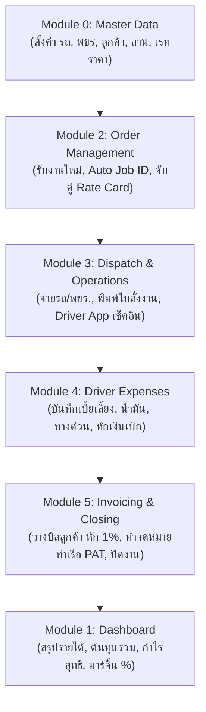

# เอกสารโครงสร้างและกระบวนการทำงานระบบ TMS (Connect Transport Co., Ltd.)
**เวอร์ชันปัจจุบัน: Version 1.1 (Baseline Blueprint สำหรับการ Re-engineer & Revision)**  
**วันที่จัดทำ:** 15 ตุลาคม 2026  
**จัดทำโดย:** Senior Full-Stack Web Developer & Mentor

---

## 📌 บทนำและคำแนะนำในการนำเอกสารนี้ไปใช้งาน
เอกสารฉบับนี้รวบรวม **โครงสร้างฐานข้อมูล (Database Schemas), กระบวนการทำงาน (Business Flows), หน้าจอ (Screens), ฟังก์ชันการทำงาน (Functions), สูตรการคำนวณ (Formulas), และแบบฟอร์มเอกสาร (Printable Forms)** ทั้งหมดของระบบ Version 1 ปัจจุบัน 

**วัตถุประสงค์:**  
เพื่อให้คุณและทีมงานของ **Connect Transport Co., Ltd. (ผู้บริหาร, ฝ่าย CS, Dispatcher, การเงิน, พขร.)** ใช้เป็นพิมพ์เขียวอ้างอิง (Baseline) ในการ **วงกลม, ขีดฆ่า, เพิ่มเติมคอลัมน์, ปรับเปลี่ยนขั้นตอน, หรือแนบแบบฟอร์ม Excel ที่ใช้งานจริง** แล้วส่งกลับมา เพื่อให้ผู้พัฒนาทำการปรับปรุงระบบทั้งระบบ (System Overhaul) ได้อย่างตรงจุดและไม่สูญเสียความสมบูรณ์ของโครงสร้างระบบ

---

## 1. ภาพรวมสถาปัตยกรรมระบบ (System Architecture)
- **Frontend & Backend:** Next.js (App Router) + TypeScript
- **Styling & UI Components:** Tailwind CSS (v4) + shadcn/ui
- **Database:** Supabase (PostgreSQL 15+)
- **Security & Access Control:** Role-Based Access Control (RBAC) + Audit Trail Logger
- **Version Control & CI/CD:** GitHub + Vercel Auto-Deployment

---

## 2. ตารางฐานข้อมูลและคอลัมน์ทั้งหมดในระบบ (Database Schema Checklist)

### 2.1 ตาราง `vehicles` (ข้อมูลรถบรรทุก)
| ชื่อคอลัมน์ (Column) | ประเภท (Type) | ความหมาย / การใช้งานในระบบ | ช่องสำหรับทีมงานระบุการแก้ไข (To-Be) |
|---|---|---|---|
| `id` | UUID (PK) | รหัสอ้างอิงภายในระบบ | |
| `plate_number` | VARCHAR(50) | ป้ายทะเบียนรถ (Unique) เช่น 70-9821 กทม. | |
| `vehicle_type` | VARCHAR(50) | ชนิดรถ: `4_wheel`, `6_wheel`, `10_wheel`, `trailer`, `semi_trailer` | |
| `capacity_tons` | NUMERIC(10,2) | น้ำหนักบรรทุกสูงสุด (ตัน) | |
| `iso_expiry_date` | DATE | วันหมดอายุตรวจสภาพ ISO 39001 | |
| `insurance_expiry_date`| DATE | วันหมดอายุประกันภัยชั้น 1/3 | |
| `act_expiry_date` | DATE | วันหมดอายุ พรบ. ขนส่ง | |
| `status` | VARCHAR(20) | สถานะรถ: `active` (พร้อมใช้), `maintenance` (เข้าซ่อม), `inactive` | |
| `created_at` | TIMESTAMPTZ | วันที่บันทึกข้อมูล | |
| *(คอลัมน์ที่ต้องการเพิ่ม)* | | *(เช่น ยี่ห้อรถ, เลขคัสซี, รหัส GPS, ประเภทยาง)* | |

---

### 2.2 ตาราง `drivers` (ข้อมูลพนักงานขับรถ / พขร.)
| ชื่อคอลัมน์ (Column) | ประเภท (Type) | ความหมาย / การใช้งานในระบบ | ช่องสำหรับทีมงานระบุการแก้ไข (To-Be) |
|---|---|---|---|
| `id` | UUID (PK) | รหัสอ้างอิง พขร. | |
| `name` | VARCHAR(150) | ชื่อ - นามสกุล พขร. | |
| `phone` | VARCHAR(50) | เบอร์โทรศัพท์ติดต่อ | |
| `license_number` | VARCHAR(50) | เลขที่ใบขับขี่ (เช่น ท.4-xxxxxxx) | |
| `license_expiry_date` | DATE | วันหมดอายุใบอนุญาตขับขี่ | |
| `daily_rate` | NUMERIC(10,2) | เบี้ยเลี้ยงพื้นฐานรายวัน (ค่าเริ่มต้น 500-650 บ.) | |
| `status` | VARCHAR(20) | สถานะ: `available` (พร้อมวิ่ง), `on_job` (กำลังวิ่งงาน), `leave` (ลา) | |
| *(คอลัมน์ที่ต้องการเพิ่ม)* | | *(เช่น รหัสพนักงาน, เลขบัตร ปชช., วงเงินเบิกล่วงหน้าสูงสุด)* | |

---

### 2.3 ตาราง `customers` (ข้อมูลบริษัทลูกค้า)
| ชื่อคอลัมน์ (Column) | ประเภท (Type) | ความหมาย / การใช้งานในระบบ | ช่องสำหรับทีมงานระบุการแก้ไข (To-Be) |
|---|---|---|---|
| `id` | UUID (PK) | รหัสลูกค้า | |
| `company_name` | VARCHAR(200) | ชื่อบริษัทลูกค้า (เช่น บจก. สยาม โลจิสติกส์) | |
| `tax_id` | VARCHAR(50) | เลขประจำตัวผู้เสียภาษี 13 หลัก | |
| `contact_name` | VARCHAR(150) | ชื่อผู้ประสานงาน / ฝ่ายจัดส่ง | |
| `phone` | VARCHAR(50) | เบอร์โทรศัพท์ | |
| `email` | VARCHAR(100) | อีเมลสำหรับส่งเอกสาร / วางบิล | |
| `address` | TEXT | ที่อยู่ตามภพ.20 สำหรับออกใบแจ้งหนี้ | |
| *(คอลัมน์ที่ต้องการเพิ่ม)* | | *(เช่น เครดิตเทอมกี่วัน, สายเรือหลักที่ใช้, เงื่อนไขวางบิล)* | |

---

### 2.4 ตาราง `locations` (ข้อมูลสถานที่: ลานตู้, ท่าเรือ, โรงงาน)
| ชื่อคอลัมน์ (Column) | ประเภท (Type) | ความหมาย / การใช้งานในระบบ | ช่องสำหรับทีมงานระบุการแก้ไข (To-Be) |
|---|---|---|---|
| `id` | UUID (PK) | รหัสสถานที่ | |
| `name` | VARCHAR(200) | ชื่อสถานที่ (เช่น ท่าเรือแหลมฉบัง C0, ลานตู้ บึงทองคำ) | |
| `location_type` | VARCHAR(50) | ประเภท: `depot` (ลานตู้), `port` (ท่าเรือ), `factory` (โรงงาน), `yard` (ลานจอด) | |
| `province` | VARCHAR(100) | จังหวัด | |
| `address` | TEXT | ที่อยู่ / พิกัด GPS / จุดสังเกต | |
| *(คอลัมน์ที่ต้องการเพิ่ม)* | | *(เช่น ช่วงเวลาเปิด-ปิด Gate, เบอร์โทรลาน, สายเรือที่รับฝาก)* | |

---

### 2.5 ตาราง `rate_cards` (ตารางเรทราคามาตรฐานแยกตามเส้นทาง)
| ชื่อคอลัมน์ (Column) | ประเภท (Type) | ความหมาย / การใช้งานในระบบ | ช่องสำหรับทีมงานระบุการแก้ไข (To-Be) |
|---|---|---|---|
| `id` | UUID (PK) | รหัสเรทราคา | |
| `origin_id` | UUID (FK) | รหัสสถานที่ต้นทาง (เชื่อมกับ `locations.id`) | |
| `destination_id` | UUID (FK) | รหัสสถานที่ปลายทาง (เชื่อมกับ `locations.id`) | |
| `vehicle_type` | VARCHAR(50) | ประเภทรถที่ใช้ในเรทนี้ | |
| `base_price` | NUMERIC(12,2) | ราคาค่าบริการเรียกเก็บลูกค้า (บาท) | |
| `fuel_cost_est` | NUMERIC(12,2) | ต้นทุนค่าน้ำมันประมาณการต่อเที่ยว | |
| `toll_fee_est` | NUMERIC(12,2) | ค่าทางด่วนประมาณการ | |
| `driver_fee_est` | NUMERIC(12,2) | ค่าแรง / เบี้ยเลี้ยง พขร. ประมาณการ | |
| *(คอลัมน์ที่ต้องการเพิ่ม)* | | *(เช่น ขนาดตู้ 20'/40', แยกเรทตู้หนัก/ตู้เปล่า, ค่าค้างคืน)* | |

---

### 2.6 ตาราง `jobs` (คำสั่งงานขนส่ง / Order & Dispatch Core)
| ชื่อคอลัมน์ (Column) | ประเภท (Type) | ความหมาย / การใช้งานในระบบ | ช่องสำหรับทีมงานระบุการแก้ไข (To-Be) |
|---|---|---|---|
| `id` | UUID (PK) | รหัสอ้างอิงงาน | |
| `job_no` | VARCHAR(50) | หมายเลขงานอัตโนมัติ (เช่น TMS-2026-001) | |
| `job_date` | DATE | วันที่รับงาน / วันที่วิ่งงาน | |
| `job_type` | VARCHAR(50) | 4 ประเภท: `heavy_to_open`, `empty_to_stuff`, `empty_return`, `yard_move` | |
| `customer_id` | UUID (FK) | ลูกค้าผู้ว่าจ้าง | |
| `origin_id` | UUID (FK) | สถานที่รับตู้/รับสินค้า | |
| `destination_id` | UUID (FK) | สถานที่ส่งตู้/ส่งสินค้า | |
| `vehicle_id` | UUID (FK) | รถที่จ่ายให้วิ่งงาน (Nullable) | |
| `driver_id` | UUID (FK) | พขร. ที่มอบหมาย (Nullable) | |
| `vehicle_type` | VARCHAR(50) | ประเภทรถที่ต้องการ | |
| `container_size` | VARCHAR(20) | ขนาดตู้: `20`, `40`, `45` ฟุต | |
| `container_type` | VARCHAR(20) | ชนิดตู้: `DC` (แห้ง), `HC` (สูง), `OT` (เปิดหลังคา), `RH` (เย็น) | |
| `cargo_type` | VARCHAR(20) | ชนิดสินค้า: `NON_DG` (ทั่วไป), `DG` (อันตราย) | |
| `status` | VARCHAR(30) | `draft`, `assigned`, `in_progress`, `completed`, `cancelled` | |
| `container_no` | VARCHAR(50) | หมายเลขตู้คอนเทนเนอร์ (พขร. กรอกหรือรับมา) | |
| `seal_no` | VARCHAR(50) | หมายเลขซีลล็อคตู้ (พขร. กรอก) | |
| `temperature` | NUMERIC(5,2) | อุณหภูมิตู้แช่เย็น Reefer (°C) | |
| `checkin_location` | TEXT | พิกัดหรือข้อความเช็คอินของ พขร. | |
| `driver_notes` | TEXT | หมายเหตุหน้างานของ พขร. | |
| `revenue` | NUMERIC(12,2) | ยอดราคาขายเรียกเก็บลูกค้า (บาท) | |
| `fuel_cost` | NUMERIC(12,2) | ค่าน้ำมันจริง | |
| `driver_allowance`| NUMERIC(12,2) | เบี้ยเลี้ยง พขร. จริง | |
| `toll_fee` | NUMERIC(12,2) | ค่าทางด่วนจริง | |
| `waiting_fee` | NUMERIC(12,2) | ค่าเสียเวลาจอดรอ (Waiting Penalties) | |
| `ot_fee` | NUMERIC(12,2) | ค่าล่วงเวลา (OT) | |
| `other_cost` | NUMERIC(12,2) | ค่าใช้จ่ายอื่นๆ | |
| `total_cost` | NUMERIC(12,2) | ต้นทุนรวมจริง = น้ำมัน+เบี้ยเลี้ยง+ทางด่วน+รอ+OT+อื่นๆ | |
| `net_profit` | NUMERIC(12,2) | กำไรสุทธิ = revenue - total_cost | |
| `pat_letter_required`| BOOLEAN | ติ๊กเลือกว่าต้องทำจดหมายเปลี่ยนใบเสร็จท่าเรือหรือไม่ | |
| `pat_letter_status`| VARCHAR(30) | สถานะ PAT: `none`, `pending`, `issued`, `completed` | |
| *(คอลัมน์ที่ต้องการเพิ่ม)* | | *(เช่น สายเรือ Shipping Line, เลข Booking, เลข B/L, ท่าเรือ Gate-in)* | |

---

### 2.7 ตาราง `driver_expenses` (บันทึกค่าใช้จ่ายและเงินเบิก พขร.)
| ชื่อคอลัมน์ (Column) | ประเภท (Type) | ความหมาย / การใช้งานในระบบ | ช่องสำหรับทีมงานระบุการแก้ไข (To-Be) |
|---|---|---|---|
| `id` | UUID (PK) | รหัสรายการ | |
| `job_id` | UUID (FK) | ผูกกับงาน Job ID | |
| `driver_id` | UUID (FK) | ผูกกับ พขร. | |
| `expense_type` | VARCHAR(50) | ประเภท: `per_diem`, `fuel`, `toll`, `waiting`, `overtime`, `advance` | |
| `amount` | NUMERIC(10,2) | จำนวนเงิน (บาท) | |
| `description` | TEXT | รายละเอียด เช่น เลขที่ใบเสร็จปั๊มน้ำมัน, ด่านทางด่วน | |
| `status` | VARCHAR(30) | `approved`, `pending`, `reimbursed` | |
| *(คอลัมน์ที่ต้องการเพิ่ม)* | | *(เช่น แนบรูปสลิป/ใบเสร็จ, เลขไมล์ต้น-ปลาย, ลิตรน้ำมัน)* | |

---

### 2.8 ตาราง `audit_logs` (บันทึกประวัติการทำงาน Audit Trail)
| ชื่อคอลัมน์ (Column) | ประเภท (Type) | ความหมาย / การใช้งานในระบบ | ช่องสำหรับทีมงานระบุการแก้ไข (To-Be) |
|---|---|---|---|
| `id` | VARCHAR(100) | รหัส Log | |
| `user_id` | VARCHAR(100) | รหัสผู้ใช้งานที่กระทำ | |
| `user_name` | VARCHAR(150) | ชื่อผู้กระทำ | |
| `user_role` | VARCHAR(50) | สิทธิ์ขณะกระทำ (admin, md, cs, dispatcher, accountant) | |
| `action` | VARCHAR(50) | `LOGIN`, `LOGOUT`, `CREATE`, `UPDATE`, `DELETE`, `PRINT`, `CLOSE_JOB` | |
| `module` | VARCHAR(50) | โมดูลที่เกิดเหตุการณ์ | |
| `description` | TEXT | รายละเอียดเหตุการณ์โดยละเอียด | |
| `created_at` | TIMESTAMPTZ | วันและเวลาที่เกิดเหตุการณ์ | |

---

## 3. รายละเอียดกระบวนการทำงานแต่ละโมดูล (As-Is Module Workflows)

### Module 0: Master Data Management (การจัดการข้อมูลหลัก)
- **URL:** `/master-data`
- **หน้าที่:** ระบบ CRUD จัดการข้อมูลพื้นฐาน 6 แท็บ:
  1. **รถบรรทุก (Vehicles):** ทะเบียน, ประเภทรถ, ความจุตัน, ติดตามวันหมดอายุ ISO 39001, ประกันภัย, พรบ.
  2. **พนักงานขับรถ (Drivers):** ชื่อ, เบอร์โทร, เลขที่ใบขับขี่, วันหมดอายุใบขับขี่, เบี้ยเลี้ยง/วัน
  3. **ลูกค้า (Customers):** ชื่อบริษัท, เลขประจำตัวผู้เสียภาษี 13 หลัก, ผู้ติดต่อ, เบอร์โทร, ที่อยู่
  4. **สถานที่ (Locations):** ลานฝากตู้ (Depot), ท่าเรือ (Port), โรงงาน (Factory), ลานซ่อม
  5. **เรทราคามาตรฐาน (Rate Cards):** ราคาขายเรียกเก็บ และต้นทุนประมาณการ (น้ำมัน, ทางด่วน, พขร.) แยกตามคู่เส้นทาง
  6. **ประเภทงาน (Job Types Reference):** คู่มือ 4 ประเภทงานมาตรฐานของบริษัท

### Module 1: Dashboard (ภาพรวมและการวิเคราะห์ข้อมูล)
- **URL:** `/`
- **หน้าที่:** หน้าจอศูนย์ควบคุมสำหรับผู้บริหารและหัวหน้างาน แสดงผล Real-time:
  1. **Status Cards (สถานะงาน):** งานทั้งหมด, งานเสร็จสิ้น, กำลังวิ่งงาน, รอดำเนินการ
  2. **Financial Summary Cards (การเงิน):** รายได้รวม, ต้นทุนรวม, กำไรสุทธิ, อัตรากำไรสุทธิ (Margin %)
  3. **Route Performance Summary Table:** รวมผลกำไร/ขาดทุนแยกตามเส้นทาง (ต้นทาง ➔ ปลายทาง)
  4. **Latest 5 Jobs Table:** แสดงงานล่าสุด 5 รายการ พร้อมสเปกตู้และสถานะ

### Module 2: Order Management (ระบบรับงานขนส่ง)
- **URL:** `/orders`
- **หน้าที่:** เปิดใบรับงานขนส่งใหม่:
  1. **Job ID อัตโนมัติ:** รูปแบบ `TMS-YYYY-XXX` (เช่น `TMS-2026-001`)
  2. **ประเภทงาน:** ลากตู้หนักไปเปิด, ลากตู้เปล่าไปบรรจุ, ลากตู้เปล่าคืน, ย้ายลาน
  3. **เลือกลูกค้าและเส้นทาง:** เลือกต้นทาง ➔ ปลายทาง
  4. **กำหนดสเปกตู้:**
     - ขนาด: 20', 40', 45'
     - ชนิดตู้: DC (แห้ง), HC (สูง), OT (เปิดหลังคา), RH (เย็น)
     - สินค้า: Non-DG (ทั่วไป) / DG (สินค้าอันตราย)
  5. **Rate Card Auto-matching:** ตรวจสอบตาราง Rate Card อัตโนมัติเมื่อเลือกเส้นทางและประเภทรถ แล้วใส่ราคาขายและต้นทุนประมาณการให้อัตโนมัติ
  6. **PAT Letter Checkbox:** ระบุว่าต้องทำจดหมายเปลี่ยนใบเสร็จท่าเรือหรือไม่

### Module 3: Dispatch & Operations (การจ่ายงานและปฏิบัติการ)
- **URL:** `/dispatch`
- **หน้าที่:** มอบหมายงานและควบคุมการวิ่งงาน แบ่งเป็น 2 แท็บ:
  1. **แท็บจ่ายงาน & คำนวณต้นทุน:**
     - เลือกทะเบียนรถ (เฉพาะรถที่สถานะ `active`)
     - เลือก พขร. (เฉพาะ พขร. ที่สถานะ `available`)
     - ปรับสถานะเป็น *มอบหมายแล้ว* หรือ *กำลังวิ่งงาน*
     - คำนวณต้นทุนจริง (น้ำมัน, ค่าแรง, ทางด่วน, จอดรอ, OT, อื่นๆ)
     - **พิมพ์ใบสั่งงาน พขร. (Job Order Sheet):** เอกสารทางการพร้อมจุดเซ็น 3 ฝ่าย
  2. **แท็บ Driver App (พอร์ทัล พขร. ภาคสนาม):**
     - ปุ่มเช็คอินพิกัดด่วน (ถึงต้นทาง, ถึงปลายทาง, ระหว่างทาง) บันทึกเวลาอัตโนมัติ
     - ช่องบันทึกหมายเลขตู้คอนเทนเนอร์ (Container No.) และหมายเลขซีล (Seal No.)
     - ช่องบันทึกอุณหภูมิตู้ (°C) สำหรับตู้เย็น Reefer
     - ปุ่ม "จบงาน & ส่งมอบตู้สำเร็จ (Complete Job)"

### Module 4: Driver Allowance & Expenses (เบี้ยเลี้ยงและค่าใช้จ่าย พขร.)
- **URL:** `/expenses`
- **หน้าที่:** บันทึกและควบคุมค่าใช้จ่าย พขร. ประจำเที่ยววิ่ง:
  1. **บันทึก 6 หมวดค่าใช้จ่าย:**
     - เบี้ยเลี้ยงรายวัน (Per Diem)
     - ค่าน้ำมัน (Fuel Cost)
     - ค่าทางด่วน (Toll Fees)
     - ค่าเสียเวลาจอดรอ (Waiting Penalties)
     - ค่าล่วงเวลา (OT)
     - เงินเบิกสำรองล่วงหน้า (Advance Payment)
  2. **สรุปยอดรายบุคคล (Driver Vouchers):**
     - คำนวณ: *ยอดจ่ายสุทธิ = ค่าใช้จ่ายจริงทั้งหมด - เงินที่เบิกไปแล้ว*
     - **พิมพ์ใบสำคัญเคลียร์เงิน พขร. (Driver Payment Voucher):** เอกสารแจกแจงรายการหักเงินเบิกและช่องเซ็นชื่อ พขร. + การเงิน

### Module 5: Invoicing & Closing (การออกบิลและการปิดงาน)
- **URL:** `/invoicing`
- **หน้าที่:** ระบบวางบิลลูกค้าและปิดงาน แบ่งเป็น 2 แท็บ:
  1. **แท็บการออกใบแจ้งหนี้ (Invoices):**
     - **พิมพ์ใบแจ้งหนี้ / ใบวางบิล (Tax Invoice / Billing Note):**
     - หัวบิล Connect Transport Co., Ltd., เลขประจำตัวผู้เสียภาษี 13 หลัก
     - รายการเที่ยววิ่ง สเปกตู้ เลขตู้ ซีล ทะเบียนรถ พขร.
     - **คำนวณภาษีหัก ณ ที่จ่าย 1% (WHT 1%):** ตามประมวลรัษฎากรงานบริการขนส่งในไทย
     - ข้อมูลบัญชีธนาคารสำหรับโอนเงิน
     - ปุ่ม **"ปิดงาน (Close Job)"** ปรับสถานะเป็น Completed และสรุปกำไร
  2. **แท็บจดหมายเปลี่ยนใบเสร็จท่าเรือ (PAT Letters):**
     - **พิมพ์จดหมาย PAT Letter:** หนังสือทางการส่งถึงการท่าเรือแห่งประเทศไทย
     - ระบุขอเปลี่ยนชื่อใบเสร็จรับเงินจากการท่าเรือฯ จาก บจก. คอนเนค ทรานสปอร์ต ให้เป็นในนาม **"บริษัทลูกค้า"** (พร้อมเลขผู้เสียภาษี 13 หลัก และเลขตู้คอนเทนเนอร์)
     - มีจุดประทับตราและลงนามกรรมการผู้จัดการ

### Module RBAC & Security: การจัดการผู้ใช้และสิทธิ์
- **URL:** `/users-roles` และ `/login`
- **หน้าที่:**
  1. **ระบบ Login / Password:** มีบัญชีผู้ใช้และรหัสผ่านแยกตามแผนก พร้อมทางลัด One-Click Demo
  2. **5 บทบาทมาตรฐาน (Roles):** Admin, MD, Customer Support, Dispatcher, Accountant
  3. **Screen Permissions Matrix:** สามารถสร้าง Role ใหม่ และติ๊ก Checkbox เปิด-ปิดสิทธิ์แต่ละหน้าจอได้อย่างอิสระ
  4. **RoleGuard:** ระบบบล็อกหน้าจอหากไม่มีสิทธิ์ และแสดงไอคอนแม่กุญแจ 🔒 บนเมนู

### Module Audit Trail: บันทึกประวัติการทำงาน
- **URL:** `/audit-logs`
- **หน้าที่:** บันทึก Timestamp, ชื่อผู้กระทำ, Role, โมดูล, และการกระทำ (LOGIN, CREATE, UPDATE, DELETE, PRINT, CLOSE_JOB) พร้อมพิมพ์รายงานได้

---

## 4. สูตรการคำนวณทั้งหมดในระบบปัจจุบัน (Current Calculation Logic)

### 4.1 สูตรการเงินประจำเที่ยววิ่ง (Job Financials):
$$\text{Total Cost} = \text{Fuel} + \text{Driver Allowance} + \text{Toll} + \text{Waiting} + \text{OT} + \text{Other}$$
$$\text{Net Profit} = \text{Revenue} - \text{Total Cost}$$
$$\text{Margin \%} = \left(\frac{\text{Net Profit}}{\text{Revenue}}\right) \times 100$$

### 4.2 สูตรเคลียร์เงิน พขร. (Driver Settlement):
$$\text{Operating Expenses} = \text{Per Diem} + \text{Fuel} + \text{Toll} + \text{Waiting} + \text{OT}$$
$$\text{Net Payable to Driver} = \text{Operating Expenses} - \text{Advance Payments}$$

### 4.3 สูตรใบแจ้งหนี้ลูกค้า (Invoice Billing):
$$\text{Withholding Tax (WHT 1\%)} = \text{Subtotal (Revenue)} \times 0.01$$
$$\text{Net Total Payable by Customer} = \text{Subtotal} - \text{WHT 1\%}$$

---

## 5. แบบฟอร์มเอกสารที่มีในระบบปัจจุบัน (Printable Templates)
1. **ใบสั่งงาน พขร. (Job Order Sheet):** แสดงในหน้า `/dispatch`
2. **ใบสำคัญเคลียร์เงิน พขร. (Driver Payment Voucher):** แสดงในหน้า `/expenses`
3. **ใบแจ้งหนี้ / ใบวางบิล (Tax Invoice / Billing Note):** แสดงในหน้า `/invoicing`
4. **หนังสือขอเปลี่ยนใบเสร็จการท่าเรือแห่งประเทศไทย (PAT Letter):** แสดงในหน้า `/invoicing`
5. **รายงานประวัติการทำงาน (Audit Trail Report):** แสดงในหน้า `/audit-logs`

---

## 6. คำแนะนำสำหรับคุณและทีมงานในการกรอกข้อมูลเพื่อส่งกลับมา Revision

เมื่อคุณนำเอกสารนี้ไปคุยกับผู้บริหารและทีมงาน ให้เตรียมข้อมูลส่งกลับมาดังนี้ครับ:

1. **คอลัมน์ใหม่ที่ต้องการเพิ่มในแต่ละตาราง:**
   - เช่น ในตารางรับงาน ต้องการเพิ่ม: เลข Booking, เลข B/L, สายการเดินเรือ (Shipping Line), เวลา Cut-off คืนตู้ท่าเรือ ฯลฯ
2. **Business Flow ที่ต้องการปรับเปลี่ยน:**
   - เช่น อยากให้ พขร. เช็คอินกี่จุด (เช่น 1. ถึงลานรับตู้เปล่า ➔ 2. ถึงโรงงานลูกค้า ➔ 3. ถึงท่าเรือ ➔ 4. คืนตู้ลาน)
3. **สูตรการคิดเงินหรือเงื่อนไขพิเศษ:**
   - เช่น ค่าน้ำมันคิดตามระยะทางกิโลเมตรจริง (ลิตรละกี่บาท), ค่าเที่ยว พขร. คิดเป็นเที่ยววิ่งแทนรายวัน, ค่าล่วงเวลาคิดเป็นชั่วโมง
4. **แบบฟอร์มเอกสารที่ใช้จริง:**
   - แนบตัวอย่างไฟล์ Excel / PDF หรือภาพถ่ายแบบฟอร์มใบสั่งงาน ใบวางบิล หรือจดหมายท่าเรือที่บริษัท Connect Transport ใช้งานอยู่จริงในปัจจุบัน
5. **ข้อมูล Mock Data จริง:**
   - ทะเบียนรถจริงของบริษัท, รายชื่อ พขร. จริง, รายชื่อลูกค้าและโรงงานจริง
